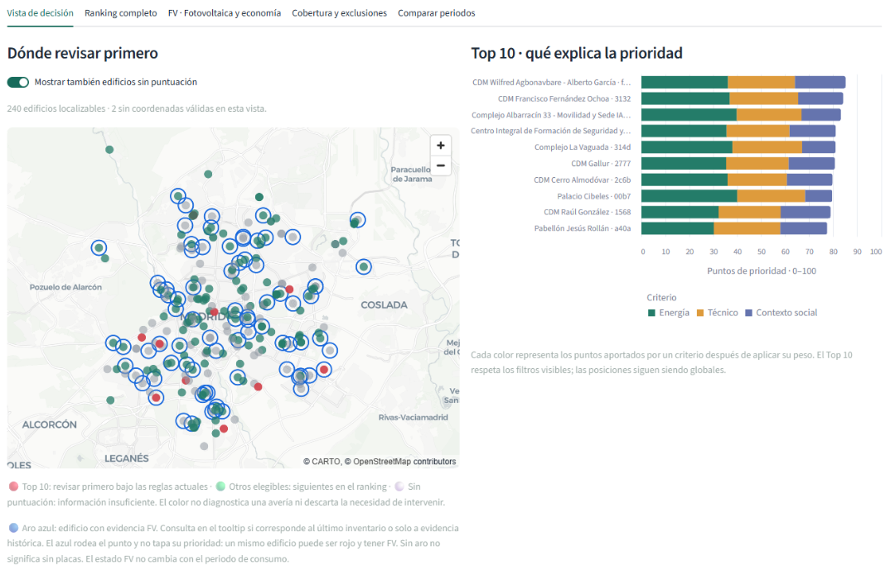
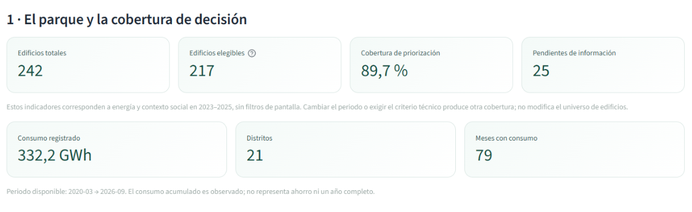
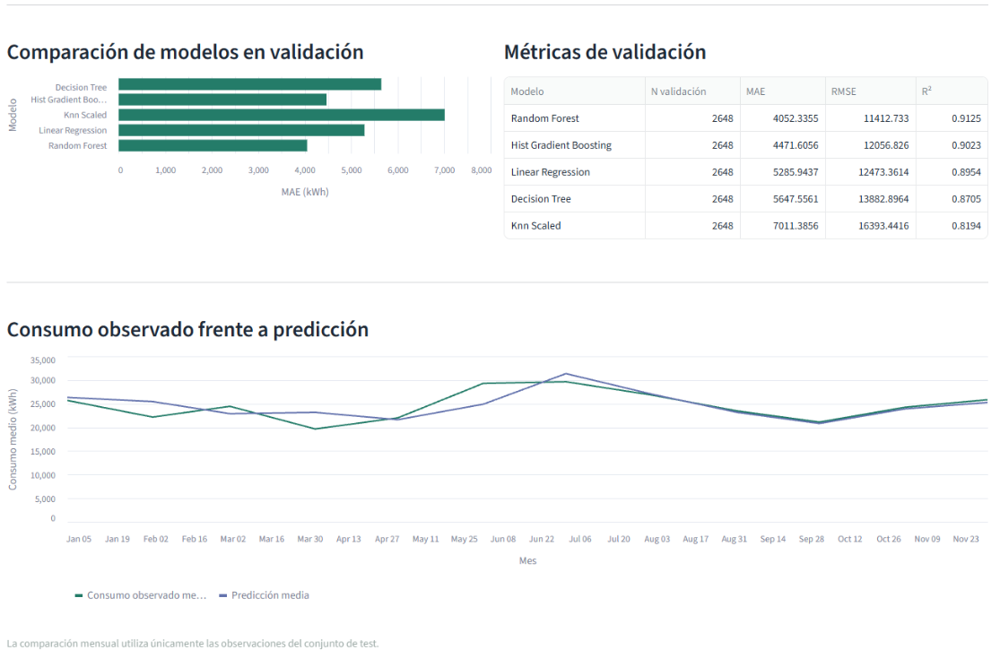
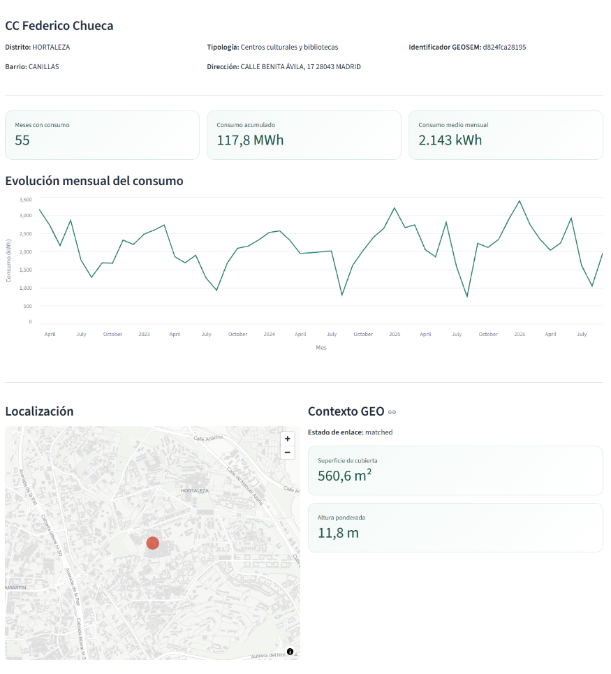
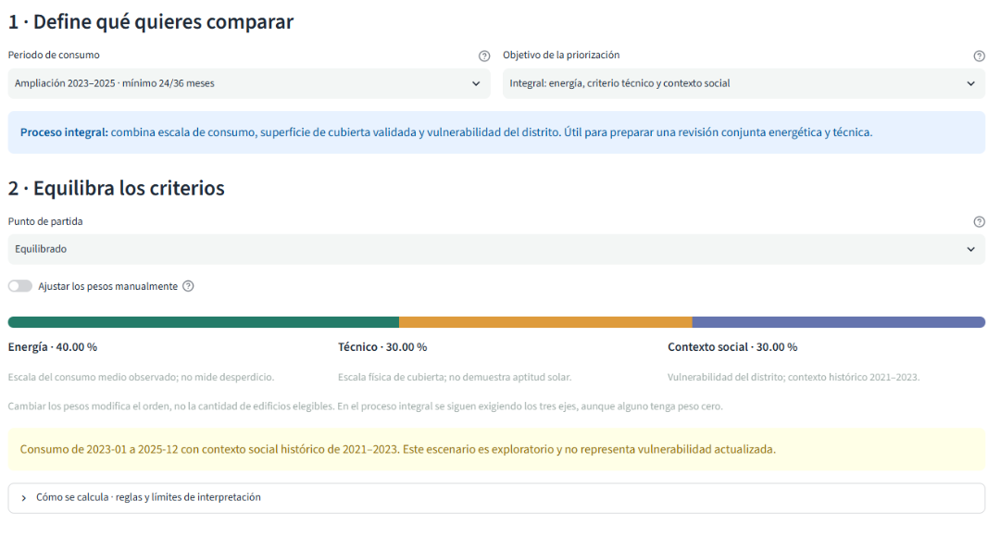

# GEOSEM Madrid

## Consumo energético y prioridades de revisión en edificios municipales

Portfolio de Marta González Vázquez. Caso de estudio basado en el Trabajo Fin de Máster GEOSEM Madrid, evaluado con **10/10**.

GEOSEM reúne datos abiertos para consultar el consumo eléctrico de edificios municipales, evaluar su consumo esperado y comparar prioridades de revisión con criterios explícitos. La aplicación permite pasar de la visión del parque a la consulta de un edificio y explorar cómo cambia el ranking al modificar periodos y ponderaciones.

  <strong>Datos abiertos de Madrid · Analítica energética · Apoyo a la decisión</strong>

  <a href="GEOSEM_Madrid_Portfolio.pdf"><strong>Ver presentación del proyecto en PDF</strong></a>
  &nbsp; · &nbsp;
  <a href="#recorrido-visual">Explorar la aplicación en imágenes</a>

*El mapa sitúa los edificios y el Top 10 explica qué aporta cada criterio. El aro azul indica evidencia fotovoltaica y conserva el color de prioridad.*

## Alcance del proyecto

| Dimensión | Resultado documentado |
| --- | --- |
| Edificios | 242 |
| Distritos de Madrid | 21 |
| Panel actualizado | 13.361 observaciones de edificio y mes |
| Periodo del panel | Marzo de 2020 a septiembre de 2026 |
| Modelo seleccionado | Random Forest, por MAE en validación |
| MAE en test de 2025 | Aproximadamente 4.307 kWh |
| R² en test | 0,935 |

El panel actualizado y la evaluación del modelo corresponden a cortes distintos. Las métricas proceden del modelo de referencia anterior a la incorporación de septiembre de 2026. El comportamiento varía entre edificios y el resultado global no garantiza el mismo ajuste individual.

## Qué permite hacer la aplicación

### Resumen ejecutivo

Consultar el universo de edificios, la cobertura disponible y los resultados guardados del modelo. Diferenciar el parque completo de los edificios que cumplen los requisitos de cada escenario.

### Modelo y predicciones

Comparar los cinco algoritmos evaluados, consultar el consumo observado frente a las estimaciones y revisar los errores por edificio. La aplicación muestra resultados ya calculados.

### Ficha de edificio

Consultar el histórico de consumo, la ubicación, la evidencia geoespacial y fotovoltaica y el contexto social del distrito.

### Priorización y escenarios

Elegir periodos y requisitos de información, ajustar los pesos energético, técnico y social, consultar el mapa y el Top 10 y exportar los resultados de la selección.

Para 2023–2025, con al menos 24 de 36 meses de consumo, el proceso de energía y contexto social incluye **217 edificios**. El proceso integral, que exige también evidencia técnica aceptada, incluye **140**. Cambiar los pesos modifica el orden de revisión, no los requisitos de elegibilidad.

En el mapa, el aro azul identifica evidencia fotovoltaica y conserva el color de prioridad del edificio. La ausencia de enlace fotovoltaico no acredita ausencia de instalación.

## Recorrido visual

### 01. Entender el parque municipal

El resumen ejecutivo muestra el universo de edificios, la cobertura disponible y los resultados del modelo.

### 02. Consultar el comportamiento del modelo

La comparación en validación y la evolución observada frente a la estimada ayudan a interpretar el resultado predictivo.

### 03. Revisar un edificio

La ficha permite consultar su consumo histórico y su localización junto a la evidencia técnica disponible.

  

### 04. Comparar criterios de prioridad

El usuario elige el periodo, los requisitos de información y el peso de cada criterio. Los pesos cambian el orden de revisión, no la elegibilidad.

Las capturas muestran consultas concretas de la aplicación del TFM. La cobertura depende del periodo y de los requisitos elegidos.

## Cómo se construye la evidencia

El proyecto integra energía, meteorología y capas territoriales mediante módulos Python reutilizables y once notebooks. Separa cronológicamente entrenamiento, validación y test y contrasta los modelos con referencias temporales. Dispone de controles del pipeline y de un control adicional de la interfaz.

El modelo utiliza histórico de consumo y variables explicativas disponibles en su diseño. La priorización posterior combina consumo observado y contexto. El criterio técnico utiliza superficie de cubierta con enlace geoespacial aceptado. El contexto social corresponde a indicadores históricos del distrito de 2021–2023.

## Interpretación y límites

- Un consumo elevado requiere contexto sobre tamaño, actividad y uso antes de diagnosticar ineficiencia.
- La superficie de cubierta orienta una revisión técnica. La viabilidad solar necesita un estudio específico.
- Una instalación fotovoltaica enlazada no demuestra ahorro económico ni rentabilidad.
- Las estimaciones del modelo emplean meteorología observada. Su uso como previsión operativa anticipada requeriría validación adicional.
- Las prioridades ayudan a ordenar revisiones. Una inversión requiere costes reales, ahorro potencial contrastado y validación técnica.
- La aplicación consulta resultados y calcula escenarios en memoria. No reentrena el modelo.

## Continuidad

Las mejoras propuestas incluyen validación temporal con ventanas deslizantes, ajuste de hiperparámetros, interpretabilidad e intervalos de predicción. Para apoyar inversiones también harían falta costes de intervención y características físicas y de uso más completas.

## Procedencia y autoría

GEOSEM Madrid tiene su origen en un TFM presentado por Marta González Vázquez, Carlos Fernando Otálvaro Giraldo, Andrés Felipe Castaño Cahuana y Pablo Arturo Guerra Vidal.

Este repositorio personal reúne material de presentación del caso.

## Contenido y acceso

Repositorio privado dedicado a documentación y material visual del portfolio. No contiene código fuente, datasets, modelos entrenados ni historial del repositorio de desarrollo. No se ha añadido una licencia de código.
